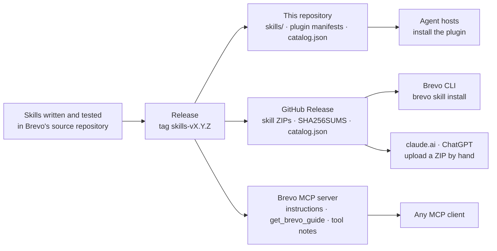

# How the skills reach agents

One page, one picture: how a skill gets from Brevo's source repository to an agent. Install steps and
each platform's limits are in [platforms.md](platforms.md).

## Diagram

## Who gets what

| Agent | Gets | Needs |
|---|---|---|
| Claude Code, Cursor, Gemini CLI, Codex, Grok | the plugin: every skill, plus the MCP server entry | installing the plugin |
| An agent with a shell | the skills installed on disk by the CLI, read from there | `npm i -g @getbrevo/cli`, then `brevo skill install` |
| claude.ai, ChatGPT | one ZIP per skill | an upload by hand; skills that need a shell have none |
| ChatGPT web, Cursor, any MCP client | guidance from the MCP server: server instructions, `get_brevo_guide`, resources, prompts, notes on tool descriptions | connecting the Brevo MCP server |

A skill acts only through the Brevo MCP server's tools; it never calls an API directly and holds
no keys. Brevo checks, before a release, that every tool a skill names exists on the server.

## Keeping a skill current

A skill that is already loaded is used as it is: the agent does not fetch it again. To see whether
a copy is behind, the agent passes the versions in its `SKILL.md` metadata to the server's
`list_brevo_guides`, which reports `current` or `stale` for each. To update: `brevo skill update`
(hash-checked), refresh the plugin, or upload the new ZIP from the latest release.
