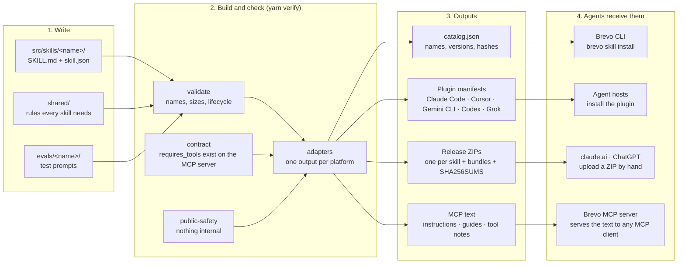

# How the skills reach agents

One page, one picture: where a skill is written, what the build produces, and how each kind of
agent receives it. The details of each step are in [architecture.md](architecture.md) and
[platforms.md](platforms.md). How a change becomes a release is in [publishing.md](publishing.md).

## Diagram

## Who gets what

| Agent | Gets | Needs |
|---|---|---|
| Claude Code, Cursor, Gemini CLI, Codex, Grok | the plugin: every skill, plus the MCP server entry | installing the plugin |
| An agent with a shell | the skills installed on disk by the CLI, read from there | `npm i -g @getbrevo/cli`, then `brevo skill install` |
| claude.ai, ChatGPT | one ZIP per skill | an upload by hand; skills that need a shell have none |
| ChatGPT web, Cursor, any MCP client | guidance from the MCP server: server instructions, `get_brevo_guide`, resources, prompts, notes on tool descriptions | connecting the Brevo MCP server |

A skill acts only through the Brevo MCP server's tools; it never calls an API directly and holds
no keys. That is why the contract check sits in the build: a skill that names a tool the server
does not have fails before it is released.
