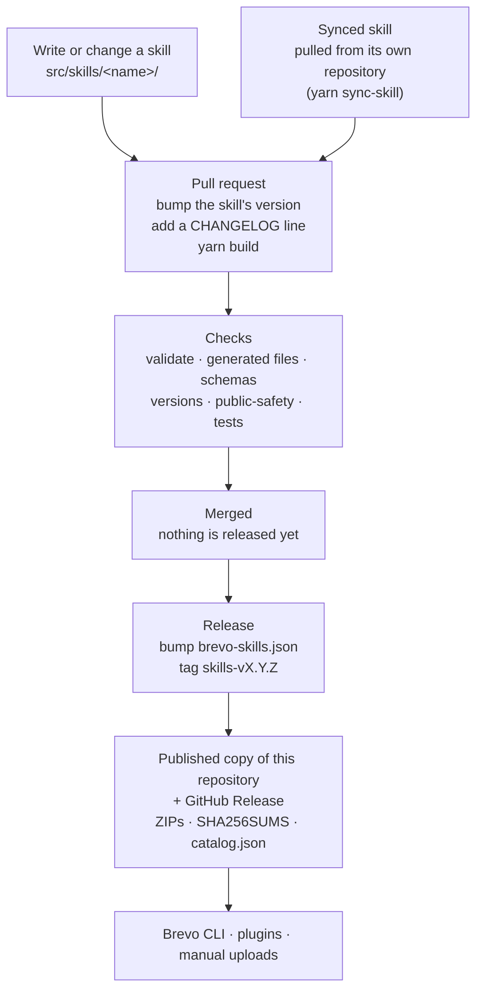

# From a change to a release

How a skill goes from an edit to the copies agents install, and how versions work. For what
the build produces and how each kind of agent receives it, see
[distribution.md](distribution.md).

## Diagram

## Steps

1. **Write.** Edit a skill in `src/skills/<name>/`. Generated files and the published folders are
   never edited by hand.
2. **Build.** Run `yarn build && yarn verify`. Commit the sources and the generated files
   together; the checks fail when they drift.
3. **Version.** When a skill's text changes, bump `version` in its `skill.json` and add a line to
   `CHANGELOG.md`. `yarn check-versions` enforces it.
4. **Merge.** Merging a pull request releases nothing.
5. **Release.** Bump `version` in `brevo-skills.json` and push a tag named `skills-v<version>`.
   The tag and the file must match. The release workflow verifies the skills, packages them and
   publishes the result.

## What a release produces

- This repository, as a copy of the source folder at that version. Nobody edits it by hand.
- A GitHub Release `v<version>` with one ZIP per skill, the bundles, `SHA256SUMS` and
  `catalog.json`. It is marked as the latest release, because the Brevo CLI reads the catalog
  from the latest release and GitHub's "latest" skips pre-releases.

`brevo skill install` reads `catalog.json` from the latest release and checks every file against
its hash before writing it. Plugins install from this repository. ZIPs are for manual uploads.

## Two kinds of version

| Version | Where | Changes when |
|---|---|---|
| Skill version | `skill.json` of each skill | that skill's text or behaviour changes |
| Release version | `brevo-skills.json` | a release is cut; it names the tag `skills-v<version>` |

## Skills written in another repository

A skill can be written in its own public repository and listed with `source` in its
`skill.json`. Its `SKILL.md` is never edited here. `yarn sync-skill <name> [--ref <ref>]` copies
the files at a release, branch, tag or commit and records the commit in `source.ref`. The sync
goes through a normal pull request, where the skill's `version` is bumped if its behaviour
changed.
